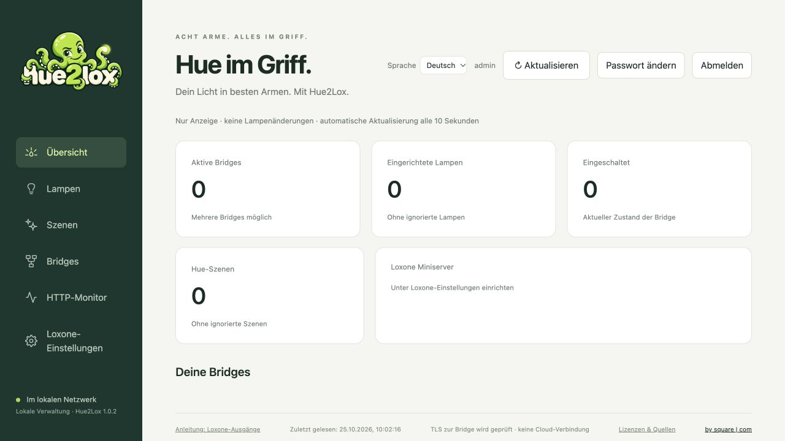

<p align="center">
  
</p>

<h1 align="center">Hue2Lox</h1>
<p align="center">Philips-Hue-Lampen und Szenen mit fertigen HTTP-Befehlen und XML-Vorlagen in Loxone einbinden.</p>
<p align="center"><a href="README.md">English</a> · Deutsch · <a href="#schnellstart">Schnellstart</a> · <a href="docs/MANUAL.de.md">Handbuch</a></p>



*Tatsächliche Oberfläche des veröffentlichten 1.0.2, mit leerer Registry vor der Kopplung. [Bildherkunft und Prüfumfang](docs/README-STRUCTURE.md#hue2lox-reference).*

## Funktionen

- **Mehrere Hue Bridges:** lokal koppeln und Lampen, Räume sowie Szenen einlesen.
- **Passende Lampensteuerung:** Schalten, Dimmen, RGB, Lumitech und Weißtemperatur nach den Bridge-Fähigkeiten.
- **Bereit für Loxone Config:** HTTP-Befehle kopieren oder ausgewählte Lampen und Szenen als XML exportieren.
- **Szenen Ein/Aus:** Hue-Szene aktivieren und ihre zugeordnete Gruppe ausschalten; „Nur aktivieren“ bleibt verfügbar.
- **Geräte finden und ordnen:** lokale Suchhilfen, Bridge-/Raumfilter und gespeicherte Nutzungsarten.
- **Lokaler Betrieb:** DE/EN-Oberfläche, dauerhafte Dateien und temporärer bereinigter HTTP-Monitor; kein Cloudkonto im laufenden Betrieb.

## Schnellstart

Für eine **Neuinstallation** auf einem Linux-Server oder einer VM mit bereits installiertem Docker Engine, Docker Compose und `curl`. Die Befehle mit Docker-Rechten ausführen, beispielsweise in einer mit `su -` geöffneten Root-Shell. Port **18443** muss frei sein. Im gewünschten übergeordneten Ordner starten; `hue2lox` darf noch nicht existieren.

```sh
mkdir hue2lox &&
cd hue2lox &&
curl --fail --location --output compose.yaml https://raw.githubusercontent.com/square-com-de/hue2lox/v1.0.2/docker/compose.quickstart.yaml &&
docker compose up -d --wait &&
docker compose ps
```

1. **http://SERVER-IP:18443** öffnen; `SERVER-IP` durch die LAN-Adresse des Linux-Servers ersetzen.
2. Bei frischen Daten mit **admin / admin** anmelden und **das Passwort ändern**. Ein vorhandenes Volume behält sein bisheriges Passwort.
3. Projektordner und benanntes Datenvolume beibehalten. Compose legt den Speicher automatisch an; die Daten liegen im Volume, nicht in `compose.yaml`.

**Dieser Start verwendet HTTP ohne TLS.** Nur im vertrauenswürdigen LAN verwenden. HTTPS muss ausdrücklich eingerichtet werden: [Traefik/Reverse Proxy oder direkte Zertifikate](docs/CONTAINER-SETUP.de.md#http-oder-https). Bei eigenem Hostnamen/Proxy `HUE_PUBLIC_URL` in der Containerumgebung setzen. Die Variable aktiviert selbst kein TLS. Port 8443/18443 allein bedeutet kein HTTPS.

Dieser Schnellstart bindet das aktuell veröffentlichte **1.0.2**, keinen unveröffentlichten Kandidaten und kein `latest`. [Release und Prüfsummen](https://github.com/square-com-de/hue2lox/releases/tag/v1.0.2) · [Runtime-Prüfumfang](docs/RUNTIME-SUPPORT.de.md).

## Erste Nutzung

1. Unter **Bridges** lokal suchen oder die Bridge-IP eingeben und mit der physischen Link-Taste koppeln. Falls Multicast-Suche scheitert, die lokale Suchhilfe verwenden; der Container muss die Bridge weiterhin direkt erreichen können.
2. Lampen und Szenen einlesen. Gewünschte Lampennutzungsarten auswählen; vor Szenen-Ein/Aus die zugeordnete AUS-Gruppe prüfen.
3. Befehle kopieren oder XML in Loxone Config importieren, Adresse/Token/Aktortyp prüfen und eine ausgewählte Lampe testen. [Bebilderte Anleitung](docs/TUTORIAL.de.md).

Szenen-AUS betrifft die gesamte zugeordnete Gruppe. Hue2Lox meldet **keine gemessenen Lampenzustände** in den Loxone-Lichtbaustein zurück. [Szenenverhalten und Grenzen](docs/features/SCENE-SWITCH.de.md).

## Weitere Installationswege

| Weg | Anleitung |
| --- | --- |
| Portainer, Docker Standalone | Dieselbe Compose-Datei als Stack: [Einrichtung](docs/CONTAINER-SETUP.de.md#portainer-docker-standalone) |
| Podman Desktop | [Schritte und getestete Plattformgrenzen](docs/DOCKER.md#podman-desktop-on-macos) |
| Nativer Linux-Installer | [Installation und Wartung](docs/INSTALL-NATIVE.md); experimentell, nur unterstützte amd64/systemd-Ziele |
| Eigenes Netzwerk, Speicher oder HTTPS | [Containerkonfiguration](docs/CONTAINER-SETUP.de.md) |

**Bereits installiert?** [Backup, Update und Rollback](docs/UPDATE-DOCKER.de.md) oder [native Wartung](docs/INSTALL-NATIVE.md) verwenden. Vollständiges Datenvolume und Konfiguration sichern; Pull/Neustart allein ersetzt keinen Container. Ein eigenes LoxBerry-Plugin ist noch nicht verfügbar.

## Dokumentation und Hilfe

[Handbuch und Fehlerbehebung](docs/MANUAL.de.md) · [Loxone-Anleitung](docs/TUTORIAL.de.md) · [Zertifikate und Wiederherstellung](docs/MAINTENANCE.de.md) · [Changelog](CHANGELOG.md) · [Lessons Learned](docs/LESSONS-LEARNED.de.md).

Fragen und Feedback: [GitHub](https://github.com/square-com-de/hue2lox/issues/new?template=feedback_question.md) oder [hue2lox@square-com.de](mailto:hue2lox@square-com.de). Für Fehler eine [Issue-Vorlage](https://github.com/square-com-de/hue2lox/issues/new/choose) mit Version und bereinigter Fehlermeldung nutzen. Keine Passwörter, Tokens, privaten Schlüssel oder XML mit Zugangsdaten veröffentlichen. [Sicherheitsmeldungen](SECURITY.md) · [Mitwirken](CONTRIBUTING.md).

## Lizenz

[Apache License 2.0](LICENSE) für eigene Projektbestandteile; Drittanbieterbedingungen bleiben bestehen. [Hinweise und Quellen](THIRD-PARTY-NOTICES.md) · [NOTICE](NOTICE). Unabhängiges Projekt ohne offizielle Verbindung zu Philips Hue oder Loxone.

<p align="center"><strong>by <a href="https://square-com.de/">square | com</a></strong> · <a href="https://square-com.de/impressum/">Impressum</a></p>
