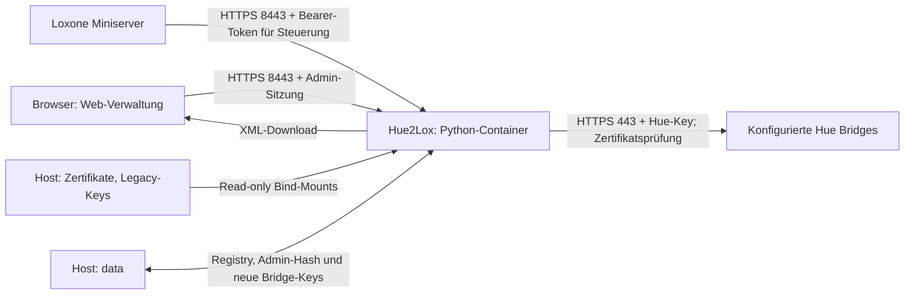

# Container-Aufbau und Architektur

Stand: 18.10.2026. Diese Übersicht beschreibt den aktuellen Quellstand des Repositorys. Angaben zum laufenden Image sind nur dort bestätigt, wo die Prüfquelle ausdrücklich genannt ist.

## Veröffentlichungsweg

Vorerst liefern wir ausschließlich Quellcode, Installer und Dockerfiles aus.
Der lokale Docker-Build bezieht das offizielle Python-Basisimage direkt vom
Upstream-Anbieter. Wir veröffentlichen keine fertigen Hue2Lox-Images in einer
Registry und keine Image-TARs oder VM-/Appliance-Abbilder als Download.
Die CI baut und prüft temporäre Images; sie ist kein Image-Veröffentlichungsweg.

Vor einem späteren Image-Vertrieb müssen die Freigabekriterien in
[RELEASE.md](../RELEASE.md#future-prebuilt-image-release-gate) erfüllt sein.
Ein grüner Schwachstellenscan ist keine Lizenzfreigabe.

## Betriebssystem und CPU-Architektur

| Ebene | Stand | Prüfquelle |
| --- | --- | --- |
| Betriebsrechner | LoxBerry/DietPi, `192.0.2.96` | Bestehendes Deployment |
| Host-Betriebssystem | Debian GNU/Linux 12, Bookworm | `/etc/os-release`, per SSH am 18.10.2026 gelesen |
| Host-CPU-Architektur | `x86_64`, Docker-Bezeichnung `amd64` | `uname -m`, per SSH am 18.10.2026 gelesen |
| Bisheriger Container-Betrieb | `linux/amd64` | Frühere Deployment-Prüfungen, siehe TEST-RESULTS.md |
| Docker CLI | 29.9.1, Build `dfc520d` | `docker --version`, per SSH am 18.10.2026 gelesen |
| Compose CLI | v5.6.0 | `docker compose version`, per SSH am 18.10.2026 gelesen |
| Container-Basis | `python:3.12-alpine` | Aktuelles docker/Dockerfile.status |
| Container-Laufzeit | CPython 3.12 auf Alpine Linux | Basis-Image; genaue Patch-/Alpine-/OpenSSL-Version hängt vom gebauten Image ab |

Compose setzt kein `platform:`. Der lokale Build verwendet somit normalerweise die Architektur des Docker-Hosts. ARM64 und andere Plattformen sind derzeit nicht als getestet dokumentiert. Host-Debian und Container-Alpine sind unterschiedliche Betriebssystemumgebungen; der Container nutzt den Linux-Kernel des Hosts.

Der Basis-Tag ist beweglich und im Dockerfile derzeit nicht auf einen Digest festgelegt. Die tatsächlich laufende Image-ID und genaue Paketversionen wurden für den jüngsten UI-Stand nicht erneut über den Docker-Daemon abgefragt: Der SSH-Benutzer `loxberry` hat keine Docker-Rechte. Dafür stehen unten gezielte Root-Prüfbefehle.

## Welche Container gibt es?

| Container/Service | Aufgabe | Lebensdauer |
| --- | --- | --- |
| Compose-Service `hue2lox` | HTTPS-Server, Webinterface, Login, Hue-Zugriff und XML-Export | Dauerhaft, Restart-Policy `unless-stopped` |
| `docker compose run --rm --no-deps hue2lox python hue_client.py` | Lesender Hue-Verbindungstest bei der Installation | Kurzlebig, wird nach dem Test entfernt |

Im bisherigen Projektpfad heißt der dauerhafte Container `hue2lox-prototype-hue2lox-1`, das lokal gebaute Image `hue2lox-prototype-hue2lox`. Compose kann diese Namen bei geändertem Projektnamen oder Verzeichnis anders erzeugen.

Weboberfläche, Login und Hue-Bridge-Anbindung laufen zusammen in einem Container. Es gibt in dieser Anwendung keinen separaten Webserver-, Datenbank-, Redis- oder MQTT-Container. Andere Dienste des LoxBerry gehören nicht zu diesem Compose-Projekt.

## Datenfluss



Der Browser steuert mit der aktuellen Verwaltungsoberfläche keine Lampe direkt. Tokenabruf und XML-Erzeugung senden keinen Hue-Schaltbefehl. Der Miniserver sendet die eigentlichen PUT-Befehle. Bridge-Pairing und automatische Lampeninventur sind implementiert. Die aktive Registry liegt unter `/data/registry.json`; siehe BRIDGES.md.

## Inhalt des Images

Verwendet wird **docker/Dockerfile.status**, ausgewählt durch `compose.yaml`. Der `Dockerfile` im Hauptordner baut dieselbe Anwendung und bleibt der Einstieg für `docker build .`. Beide verwenden `src/` für den Code und `config/registry.json` als leere Startvorlage.

```text
/app/
  src/app.py                 HTTPS-Routen, Zugriffskontrolle und JSON-Antworten
  src/hue_client.py          TLS-geprüfte Hue-v2-Abfragen und Steuerung
  src/color.py               RGB-, Kelvin- und Loxone-Lumitech-Umrechnung
  src/dashboard.py           Statusübersicht, Bridge-Zuordnung und 5-Sekunden-Cache
  src/admin_auth.py          Passwortprüfung, Sitzungen und Login-Begrenzung
  src/loxone_export.py       Befehlsdaten und Loxone-VirtualOut-XML
  src/scenes.py              Szeneninventur, Bridge-Zuordnung und statischer Aufruf
  src/bridge_store.py        Atomare persistente Registry- und Key-Speicherung
  src/bridge_admin.py        HTTPS-Erkennung, Kopplung und Lampeninventur
  config/registry.json   Startvorlage für Bridges/Lampen, nicht die aktive Registry
  trust/
    huebridge-ca.pem      Öffentliches CA-Zertifikat für die Hue Bridges
  web/
    index.html           Oberfläche einschließlich Login
    app.css              Gestaltung, Lampensymbole und aufklappbare Befehle
    app.js               Übersicht und Statusaktualisierung
    admin.js             Login, Tokenkopie, Lampenauswahl und XML-Download
    bridges.js           Hinzufügen, Link-Tasten-Kopplung und Inventur
    lamp-icons.js        20 eigene moderne Leuchten-Symbole und Zuordnung
    lamp-icons/          Editierbare SVG-Quelldateien, siehe ICONS.md
    octopus.png          Einzelnes Maskottchen als Favicon, siehe LOGO.md
    hue2lox-logo.png      Freigegebenes Logo: Oktopus hält den Schriftzug
```

Anwendungsabhängigkeiten: ausschließlich die Python-Standardbibliothek, darunter `http.server`, `http.client`, `ssl`, `hashlib`, `hmac`, `secrets` und `xml.etree.ElementTree`. Es werden im Dockerfile keine zusätzlichen pip-, npm- oder APK-Pakete installiert. Die Basis bringt ihre eigenen Systembibliotheken mit; eine vollständige Paketliste/SBOM des konkreten Images ist noch nicht versioniert. Das Frontend verwendet HTML, CSS und JavaScript ohne Build-Tool, CDN oder externe Laufzeitbibliothek. Node.js wird nur lokal zur Syntaxprüfung verwendet, nicht im Betriebscontainer.

## Was kommt vom Host?

| Host-Datei/Ordner im Projektpfad | Pfad im Container | Zweck |
| --- | --- | --- |
| `data/` | `/data`, read-write | Persistente Runtime-Registry und neue Bridge-Keys, UID 10001, Ordner 700, Dateien 600 |
| `certs/` | `/certs`, read-only | HTTPS-Serverzertifikat und privater Schlüssel |
| `secrets/hue_key` | `/run/secrets/hue_key`, read-only | Zugang zur eingerichteten EG-Hue-Bridge |
| `data/admin_auth.json` | `/data/admin_auth.json`, read-write innerhalb des geschützten State-Mounts | Benutzername, Salt und Passwort-Hash; Passwortwechsel im Web |
| `secrets/control_token` | `/run/secrets/control_token`, read-only | Hue2Lox-Bearer-Token, zusätzliches Mount aus Steuerungs-Override |

Dies sind Bind-Mounts, keine benannten Docker-Volumes und keine Swarm-Secrets. Weitere Bridge-Keys werden bei Kopplung geschützt in `/data/bridge-keys` angelegt; zusätzliche einzelne Key-Mounts sind dafür nicht erforderlich. Weder Hue-Keys noch privater TLS-Schlüssel, Passwort oder realer Token werden ins Image kopiert. `.dockerignore` schließt `data/`, die lokalen Secret-/Zertifikatsordner und `.env` vom Build-Kontext aus; `.gitignore` schließt sie von Git aus. Das öffentliche CA-Zertifikat unter `trust/` ist absichtlich im Repository.

Das Admin-Passwort wird als PBKDF2-SHA256-Hash mit 600.000 Iterationen und zufälligem Salt gespeichert. Das Hue2Lox-Steuerungstoken muss als lesbarer Wert in seiner geschützten Datei vorliegen, damit es dem angemeldeten Administrator und optional im XML ausgegeben werden kann. Admin-Sitzungen und Statuscache liegen ausschließlich im Arbeitsspeicher und gehen beim Containerneustart verloren. Der Container speichert keine eigenen Lampenzustände dauerhaft und verwendet keine Datenbank.

## Prozess und Schutz

- Start: `python -u app.py`, Arbeitsverzeichnis `/app/src`.
- UID/GID: `10001:10001`, kein Root-Prozess.
- Root-Dateisystem read-only; Zertifikats-/Legacy-Key-Mounts read-only. Ausschließlich `/data` ist für persistente Bridge-Verwaltung schreibbar.
- Alle Linux-Capabilities entfernt; `no-new-privileges:true`.
- HTTPS ab TLS 1.2 für eingehende Verbindungen und Hue-Verbindungen.
- Admin-Verwaltung mit Session-Cookie, CSRF-/Origin-/Host-Prüfung und Begrenzung von Login-Versuchen; Details in ADMIN.md.
- Loxone-Steuerung verwendet ein separates Bearer-Token; sie benötigt keine Browseranmeldung.
- Logs gehen nach stdout/stderr und werden von Docker verwaltet. Zugangsdaten werden nicht absichtlich protokolliert. Compose definiert bisher keine eigene Logrotation oder Ressourcenlimits.

## Netzwerk und Endpunkte

| Verbindung | Zweck |
| --- | --- |
| Host `HUE2LOX_BIND_IP:8443` → Container `8443/tcp` | Webinterface und Loxone-HTTPS |
| Container → konfigurierte Hue-Bridge `443/tcp` | Lokale Hue-v2-API, Zertifikatskette und Bridge-ID werden geprüft |
| Intern `127.0.0.1:8443/health` | Docker-Healthcheck mit explizitem Vertrauen in das Serverzertifikat |

Compose bindet standardmäßig nur an Host-Loopback `127.0.0.1`. Die bestehende Installation verwendet `HUE2LOX_BIND_IP=192.0.2.96`. Im Container bindet der Server standardmäßig an `0.0.0.0`; das ist unabhängig von der Host-Portfreigabe. Diese Beschreibung gilt nur für die historische Basis-Compose-Datei mit Portmapping. Die vorbereitete Neuinstallation verwendet dagegen `docker/compose.install.yaml` mit **Host-Netzwerk**, bindet an die gewählte Server-IP und den gewählten Port (Installer-Vorgabe 18443) und benötigt keine Portweiterleitung. Ihr Healthcheck verwendet diese konfigurierte Adresse. Netzwerkisolation und Portwahl daher immer anhand der tatsächlich verwendeten Compose-Datei beurteilen.

Wichtige Routen:

- `/`: Weboberfläche; Verwaltungsdaten erfordern Anmeldung.
- `/health`: öffentliches Health-JSON, keine Hue-Abfrage.
- `/hue-go/status`: bestehende lesende Diagnose, weiterhin ohne neue Admin-Sitzung erreichbar.
- `/api/overview`: Übersicht, Admin-Sitzung erforderlich.
- `/api/admin/*`: Login, Logout, Sitzung, Lampenliste, Token und Export; Details in ADMIN.md.
- `PUT /hue-go/state`: bestehende Hue-Go-Steuerung mit Bearer-Token.
- `PUT /api/lights/<bridge-id>/<light-id>/state`: Steuerung einer aktiv registrierten Lampe mit Bearer-Token.

Healthcheck: alle 30 Sekunden, Timeout 5 Sekunden, drei Fehlversuche, Startfrist 5 Sekunden. Er prüft HTTPS, HTTP 200 und exakt `{"status":"ok"}`. Ein grüner Healthcheck bestätigt den Webdienst, nicht die Erreichbarkeit jeder Hue Bridge.

## Konfiguration

| Variable | Standard im Quellstand / Zweck |
| --- | --- |
| `HUE2LOX_BIND_IP` | Compose-Hostfreigabe; Standard `127.0.0.1` |
| `HUE_PUBLIC_URL` | `https://192.0.2.96:8443`; Browser-Origin-Prüfung und XML-Basisadresse |
| `PORT` / `BIND_HOST` | Container-Port `8443` / interne Bind-Adresse `0.0.0.0` |
| `TLS_CERT` / `TLS_KEY` | `/certs/server.crt` / `/certs/server.key` |
| `HUE_ADMIN_AUTH_FILE` | `/data/admin_auth.json` |
| `HUE_CONTROL_TOKEN_FILE` | `/run/secrets/control_token` |
| `HUE_KEY_FILE` / `HUE_CA_FILE` | Hue-Key bzw. CA-Datei; Standard `/run/secrets/hue_key` und `/app/trust/huebridge-ca.pem` |
| `HUE_BRIDGE_IP` / `HUE_BRIDGE_ID` / `HUE_LIGHT_ID` | Bestehende Hue-Go-Zuordnung; Defaults im Client. Weitere Geräte über Registry |
| `HUE_REGISTRY_FILE` | Compose setzt `/data/registry.json`; ohne explizite Variable dient die Registry unter `/app/config/registry.json` als lesende Startvorlage |
| `HUE_STATE_DIR` | `/data`, einziger schreibbarer Speicher für Runtime-Registry und neue Bridge-Keys |
| `HUE_WRITES_ENABLED` | Grundfreigabe für Schalten/Dimmen; Basis-Compose `0` |
| `HUE_COLOR_ENABLED` | RGB-Freigabe; Basis-Compose `0` |
| `HUE_WHITE_ENABLED` | Kelvin-/Lumitech-Freigabe; Basis-Compose `0` |

Die bestehende Installation hat Schalten, RGB und Weiß über ihr lokales `compose.override.yaml` freigeschaltet. Die versionierten `docker/compose.control.yaml`, `docker/compose.color.yaml` und `docker/compose.white.yaml` dokumentieren die entsprechenden Ergänzungen. Compose lädt diese drei Dateien nicht automatisch: Entweder Inhalte im lokalen Override verwenden oder sie explizit mit `-f` angeben. Ein normales `.env` wird von Compose für Platzhalter ausgewertet; zusätzliche Python-Variablen müssen tatsächlich über `environment:` an den Container weitergereicht werden.

Die Registry im Image ist eine Startvorlage. Die aktive Registry und neue Bridge-Keys liegen auf dem persistenten `/data`-Mount; Änderungen durch das Webinterface wirken ohne Neubau. Änderungen an Quellcode und Webdateien erfordern Image-Neubau und Neuerstellung des Containers. Nur `docker compose restart` übernimmt einen neuen Quellstand nicht. Der Installer bewahrt die vorhandene Registry und lokale Overrides; Details in ADMIN.md.

## Laufendes Image exakt prüfen

Diese Befehle im Root-Terminal auf LoxBerry zeigen gezielt Versionen und Status, ohne die Secret-Dateien oder das komplette Container-Environment auszugeben:

```sh
cd /opt/loxberry/hue2lox-prototype
docker compose ps
docker compose images
docker image inspect hue2lox-prototype-hue2lox --format '{{.Os}}/{{.Architecture}} {{.Id}} {{json .RepoDigests}}'
docker compose exec -T hue2lox python -c 'import platform,ssl; print("Python:",platform.python_version()); print("CPU:",platform.machine()); print("TLS:",ssl.OPENSSL_VERSION)'
docker compose exec -T hue2lox cat /etc/alpine-release
```

`docker compose images` zeigt die vom Container verwendete Image-ID. Der Tag in `docker image inspect` kann bei einem Neubau bereits auf ein neueres Image als der laufende Container zeigen; in diesem Fall die konkrete laufende Image-ID aus der vorherigen Ausgabe an `docker image inspect` übergeben. Ein lokal gebautes Image hat gegebenenfalls keine RepoDigests. Die aktuelle Inventur oben erfindet daher keinen laufenden Image-Digest oder ungeprüfte Paketversionen.

## Weiterführende Dateien

- [README.de.md](../README.de.md): Einstieg und Betrieb.
- [ADMIN.md](ADMIN.md): Einrichtung des Logins, Tokenanzeige und XML-Export.
- [WEB.md](WEB.md): Oberfläche und Bridge-/Lampenmodell.
- [BRIDGES.md](BRIDGES.md): Bridge-Kopplung, Inventur und Migration auf persistenten Speicher.
- [TEST-RESULTS.md](TEST-RESULTS.md): bestätigte Tests und Grenzen.
- [ICONS.md](ICONS.md), [LOGO.md](LOGO.md): lokale Bilddateien, Herkunft und Lizenz.

## Szenen-Erweiterung

`web/scenes.js` ergänzt den Szenenbereich. `scenes.py` und `web/scenes.js` werden
von docker/Dockerfile.status und scripts/install-web.sh mit installiert. Es gibt keinen neuen
Container, Port, Mount oder Schlüssel. Szenenmetadaten liegen pro Bridge in
`/data/registry.json`; das vorhandene Bearer-Token und die Schreibfreigabe gelten
auch für Szenenaufrufe. Details und Schnittstellen: [SCENES.md](SCENES.md).

## Lokale Gerätesuche und Übersicht

`discovery.py` ergänzt begrenzte UDP-/SSDP- und mDNS-Suche sowie den gespeicherten
Miniserver-Link. `web/discovery.js` ergänzt die Auswahl und manuelle Eingabe.
Beide Dateien werden von docker/Dockerfile.status und scripts/install-web.sh mit installiert.
Es bleiben Python-Standardbibliothek, ein Container und die vorhandenen Mounts.
Es werden keine weiteren Ports veröffentlicht und keine Netzwerkmodi geändert.
Suchantworten im Docker-Netz sind installationsabhängig; Details und Prüfung:
[DISCOVERY.md](DISCOVERY.md). Szenenanzahl und Miniserver-Link ersetzen auf der
Übersicht die bisherigen zwei Lampenkarten.

## Temporärer HTTP-Monitor

`request_monitor.py` hält einen optionalen, threadgeschützten Ringpuffer für maximal
200 bereinigte Steuerungsanfragen im Prozessspeicher. Nach 600 Sekunden werden
keine weiteren Einträge aufgenommen. Es gibt keine Logdatei und keinen weiteren
Container oder Mount. `web/monitor.js` stellt die angemeldete Anzeige und
Start/Stop/Leeren/Kopieren bereit. Details: [MONITOR.md](MONITOR.md).

## Lampentypen und Modellreferenz

`lamp_types.py` ergänzt aus Bridge-Fähigkeiten Typ und Nutzungsarten. Gewählte
Modi liegen pro Lampe als `enabled_modes` im bestehenden persistenten Registry-
Datensatz. Änderungen benötigen die Admin-Sitzung und CSRF; sie schalten keine
Lampe. Tunable White nutzt den vorhandenen Lumitech-Weißdecoder.

`catalog/` enthält die lokale CSV-/JSON-Modelltabelle mit 949 Kennungen, Quelle,
Prüfsumme und MIT-Lizenz. Das Docker-Image kopiert sie nach `/app/catalog`; die
Laufzeit benötigt dafür keinen Internetzugriff. Die CSV ist als öffentliche
Modellreferenz über `/assets/hue-models.csv` erreichbar und enthält keine
Installationsdaten. Keine zusätzliche Bibliothek, kein neuer Container oder Port.

### Vorbereitete Neuinstallation – 19.10.2026

`docker/compose.install.yaml` ist ein separater Ausgangspunkt für neue Testinstallationen. `scripts/prepare-install.py` erstellt ein neues Zielverzeichnis und kopiert diese Datei als dessen `compose.yaml`. Eigene Zertifikate/Token, leere Registry, UID 10001 auf Linux/root, keine Legacy-Hue-Go-Endpunkte oder vorhandenen Bridge-Keys. docker/Dockerfile.status akzeptiert `REGISTRY_SOURCE` (Standard `config/registry.json`, frische Installation `install/registry.empty.json`). Steuerung ist zunächst gesperrt. Keine neue Python-/Node-Laufzeitabhängigkeit; Sprachdateien sind statische Assets. Siehe INSTALL.md für Test und Grenzen.

## Standard-Dockerfile

`Dockerfile` und `docker/Dockerfile.status` enthalten dieselbe Anwendung. Ein normaler
`docker build -t hue2lox .` kopiert alle benötigten Module und eine leere Registry.
Für den Betrieb werden weiterhin Zertifikate, persistente Daten und die passende
Compose-Konfiguration benötigt; der Installationsassistent bereitet diese vor.
Der GitHub-Container-Test baut zusätzlich das Standard-Dockerfile und prüft die
Anwendungsimporte und die leere Registry. Alte Prototyp-Skripte benötigen eine
explizite `HUE_PUBLIC_URL`; sie verwenden keine feste private Serveradresse mehr.
