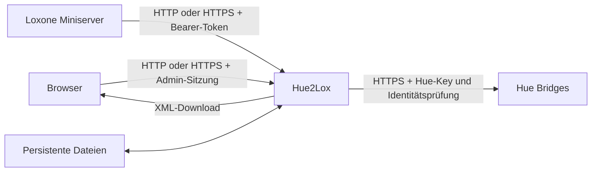

# Aufbau und Architektur

Dokumentationsstand für den unveröffentlichten 1.0.3-Kandidaten. Aktuell veröffentlicht ist 1.0.2. [Installation](../INSTALL.de.md) · [English container guide](DOCKER.md) · [Testumfang](RUNTIME-SUPPORT.de.md).

## Anwendung und Datenfluss

Hue2Lox ist ein Python-Dienst mit lokal mitgeliefertem HTML/CSS/JavaScript. Webverwaltung, Bridge-Anbindung und Loxone-HTTP-Endpunkte laufen im selben Prozess. Keine separate Datenbank, kein Redis, MQTT oder Cloudkonto für den laufenden Betrieb. Anwendungscode verwendet die Python-Standardbibliothek; Node.js wird für Entwicklungswerkzeuge benötigt, nicht zur Laufzeit.



Bei Traefik endet Browser-/Miniserver-HTTPS am Proxy; dessen Backend-Verbindung kann HTTP verwenden. Der Standardcontainer verwendet HTTP, nativ richtet der Installer direktes HTTPS ein. [Exakte Konfiguration](CONTAINER-SETUP.de.md#http-oder-https). Bridge-TLS ist davon unabhängig. Kopieren, Export, Gerätesuche und Inventur senden keine Lampenbefehle; die physische Kopplung erzeugt einen Anwendungsschlüssel auf der Bridge. Die eigentlichen Steuerungs-PUTs kommen vom Miniserver.

## Quellstruktur

| Bereich | Aufgabe |
| --- | --- |
| `src/app.py` | HTTP(S)-Server, Routen, begrenzte Anfrageverarbeitung und Zugriffsschutz |
| `src/admin_auth.py`, `src/public_address.py` | Passwort, Sitzungen und erlaubte öffentliche Adresse |
| `src/hue_client.py`, `src/color.py` | TLS-geprüfte Hue-Kommunikation und Werteumrechnung |
| `src/bridge_admin.py`, `src/bridge_store.py` | Kopplung, Inventur, atomare Registry-/Key-Dateien |
| `src/scenes.py`, `src/scene_switch.py` | Szeneninventur/Recall und geordnete Ein/Aus-Gruppenbefehle |
| `src/loxone_export.py` | Befehlsdaten und XML für virtuelle Ausgänge |
| `src/discovery.py`, `src/dashboard.py` | Lokale Suche, Statusabfragen und Cache |
| `src/request_monitor.py` | Begrenztes, temporäres bereinigtes HTTP-Protokoll |
| `src/release_version.py` | Tatsächliche Paket-/Buildidentität; kein Online-Lookup |
| `web/`, `catalog/`, `trust/` | Lokale Oberfläche, Modellreferenz und Hue-Vertrauensanker |
| `docker/`, `deployment/native/` | Container- bzw. systemd-Betrieb desselben Kerns |

`Dockerfile` und `docker/Dockerfile.status` sind identisch. Die Python-3.15-/Alpine-Basis ist per Digest festgeschrieben; `compliance/base-image.json` und die Quellen-/Inventarprüfungen binden Abhängigkeiten und Lizenzen. pip und ensurepip werden aus dem Laufzeitimage entfernt. [Quellenbeilage](IMAGE-COMPLIANCE.md).

## Container und native Installation

| Weg | Netzwerk und Zustand |
| --- | --- |
| `docker/compose.quickstart.yaml` | Portweiterleitung Host 18443 → Container 8443, HTTP, benanntes Volume `data:/data` |
| `docker/compose.traefik.yaml` | Beispiel für vorhandenen Traefik auf demselben Docker-Host; gemeinsames Netzwerk, kein direkter Host-Port, HTTP-Backend |
| `docker/compose.image.yaml` | Optionale Linux-Host-Netzvariante, HTTP-Port 18443 und benanntes Volume |
| Bestehender Docker-Installer | Eigener Installationsordner mit `.env`, Bind-Mounts für `data/`, `secrets/`, optional `certs/`; Host-Netz und gewählter Port |
| Nativer Installer | systemd, OS-Python ab 3.11, eigener Dienstbenutzer, direktes HTTPS; getrennte Systemverzeichnisse |

Die Root-Datei `compose.yaml` mit zusätzlichen `docker/compose.*`-Overrides ist ein früher Entwicklungs-/Prototypweg, nicht der aktuelle Container-Schnellstart. Ihre gesperrten Steuerungsflags und Zertifikats-Mounts sind keine Image-Defaults. Alte Wartungsskripte nicht als allgemeinen Installer ausführen.

## Persistente Dateien

| Container-Standard | Zweck |
| --- | --- |
| `/data/registry.json` | Bridges, Lampen/Szenen, Nutzungsarten und lokale Zuordnungen |
| `/data/registry.previous.json` | Vorherige Registry-Metadaten; kein vollständiges Backup |
| `/data/bridge-keys/` | Neue Hue-Kopplungsschlüssel |
| `/data/admin_auth.json` | Gesalzener PBKDF2-SHA256-Passworthash, 600.000 Iterationen |
| `/data/secrets/control_token` | Hue2Lox-Steuerungstoken |

Der Image-Einstieg legt nur fehlende Dateien an. Erhaltene Passwörter, Keys und Flags werden nicht zurückgesetzt. Bei älteren Installationen können zusätzliche Read-only-Mounts unter `/run/secrets` und `/certs` maßgeblich sein. Nativ liegen Zustand unter `/var/lib/hue2lox`, Konfiguration/Token/Zertifikate unter `/etc/hue2lox`, Programmstände unter `/opt/hue2lox` und Updatesicherungen unter `/var/backups/hue2lox`.

Keine SQLite-/SQL-Datenbank. Sitzungen, Statuscache, Szenen-Befehlshistorie und temporärer Monitor liegen im Prozessspeicher. Registry und Keys werden als geschützte Dateien atomar ersetzt. Das ersetzt keine transaktionale Gesamtsicherung; nur eine Instanz darf auf denselben Datenbestand schreiben. [Backup nach Installationsweg](MANUAL.de.md#7-update-backup-und-wiederherstellung).

## Sicherheit und Konfiguration

Container laufen als UID/GID 10001, mit schreibgeschütztem Root-Dateisystem, beschreibbarem `/data`, temporärem `/tmp`, entfernten Capabilities und `no-new-privileges`. Hostordner müssen für diesen Benutzer schreibbar sein; benannte Volumes vermeiden die manuelle Vorbereitung. Keine Zugangsdaten ins Image/Git kopieren.

| Einstellung | Container-Default / Bedeutung |
| --- | --- |
| `PORT`, `BIND_HOST` | 8443, `0.0.0.0`; veröffentlichter Host-Port ist separat |
| `HUE_PUBLIC_URL` | Nicht gesetzt: direkte lokale Browseradresse. Bei Proxy/DNS ausdrücklich setzen; aktiviert selbst kein TLS |
| `TLS_CERT`, `TLS_KEY` | Beide fehlen: HTTP. Beide gültig gesetzt: HTTPS. Unvollständige/leere Konfiguration schlägt fehl |
| `HUE_STATE_DIR` | `/data` |
| `HUE_REGISTRY_FILE`, `HUE_ADMIN_AUTH_FILE` | Image-Einstieg setzt Pfade innerhalb `/data` |
| `HUE_CONTROL_TOKEN_FILE` | Image-Einstieg setzt `/data/secrets/control_token` |
| `HUE_WRITES_ENABLED` | `1`; `0` sperrt alle Steuerungsbefehle |
| `HUE_COLOR_ENABLED`, `HUE_WHITE_ENABLED` | Je `1`; können Fähigkeiten zusätzlich sperren |
| `HUE2LOX_ADMIN_PASSWORD` | `admin`, nur zur Anlage frischer Zugangsdaten |

Verwaltung verwendet Sitzung, Origin-/Host-/CSRF-Prüfung und Login-Begrenzung. HTTPS-Sitzungen verwenden Secure-Cookies; reines HTTP ist unverschlüsselt. Steuerung benötigt Bearer-Token und aktivierte Fähigkeiten. [Details](ADMIN.md) · [Sicherheit](../SECURITY.md). Keine gemessene Zustandsrückmeldung in den Loxone-Lichtbaustein.

## Diagnose und Grenzen

Im tatsächlichen Compose-Projektordner, mit Docker-Rechten:

```sh
docker compose ps
docker compose images
docker compose exec -T hue2lox python -c 'import platform,ssl; print(platform.python_version()); print(platform.machine()); print(ssl.OPENSSL_VERSION)'
```

`/health` prüft den Dienst ohne Hue-Abfrage. Grün bedeutet weder Bridge-Erreichbarkeit noch erfolgreichen Browserlogin oder Lampenwirkung. Ein Image-Pull oder Neustart ersetzt keinen Container. [Update/Rollback](UPDATE-DOCKER.de.md) · [Native Wartung](INSTALL-NATIVE.md). Statuscache und REST-Abfragen sind kein Streaming; SSE und Loxone-Rückmeldung sind nicht enthalten. Historische Deployment-Belege stehen getrennt im [Dokumentationsindex](INDEX.md).
